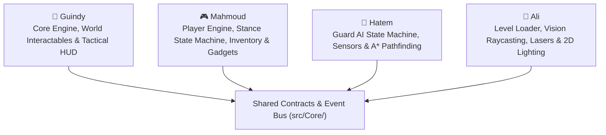
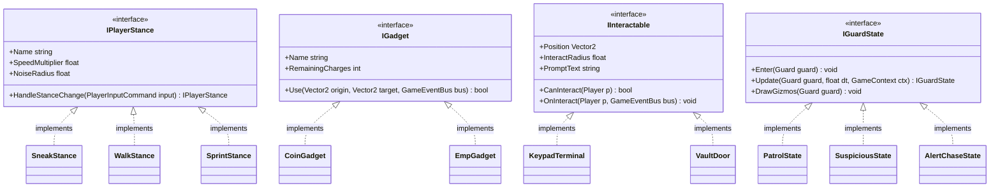

# 🕵️‍♂️ ShadowHeist (`Raylib-cs`) — 4-Week Engineering & Architecture Plan

> [!IMPORTANT]
> **Project Mission:** Build a polished **2D/3D Dual-Viewport Tactical Stealth Heist** game in C# (`Raylib-cs`) while mastering **Clean C# Architecture (SOLID, Interfaces, Design Patterns, LINQ, Unit Testing)** and **Professional GitHub Workflows (Feature Branches, Pull Requests, Mandatory Peer Code Reviews)** ahead of the Graduation Project.
> **Strategic Roadmap Update (Post-Week 2):** With Week 1 & Week 2 core simulation systems complete and in PR review, the **3D Tactical Perspective Overhaul (`Camera3D` + `[F5]` live 2D/3D toggle)** has been promoted from a post-launch bonus into **Week 3 (immediately after Week 2)** so the entire team builds and demos Weeks 3 & 4 in full 3D!

---

## 1. Team Ownership & Subsystem Architecture

To prevent merge conflicts and ensure clean separation of concerns, each engineer owns **one decoupled C# namespace/folder**, while **all 4 team members review each other's Pull Requests**.



### Subsystem Breakdown by Engineer

| Engineer | Assigned Module (`src/`) | Key Systems Owned | Core Engineering Patterns Practiced |
| :--- | :--- | :--- | :--- |
| **Guindy** | `src/Core/` & `src/HeistWorld/` | `GameContext`, `GameEventBus`, `VaultDoor`, `KeypadTerminal`, `LootCrate`, `FuseBox`, `HudRenderer`, `GameStateManager` | **Observer Pattern (Event Bus)**, **Polymorphism (`IInteractable`)**, High-Level State Management |
| **Mahmoud** | `src/PlayerSystem/` | `IInputProvider`, `PlayerMovement`, `PlayerRenderer`, Stances (`SneakStance`, `WalkStance`, `SprintStance`), `PlayerInventory`, Gadgets (`CoinGadget`, `EmpGadget`, `SuppressedPistol`) | **Dependency Injection (`IInputProvider`)**, **State Pattern (`IPlayerStance`)**, **Strategy Pattern (`IGadget`)**, **C# Collections & LINQ**, **xUnit Testing** |
| **Hatem** | `src/GuardAI/` | `Guard`, AI States (`PatrolState`, `SuspiciousState`, `AlertChaseState`), `SecurityCamera`, Detection Meter, 2D Grid `AStarPathfinder` | **Finite State Machine (`IGuardState`)**, **Graph Algorithms (A\*)**, Event-Driven AI Transitions, **xUnit Testing** |
| **Ali** | `src/WorldLighting/` | JSON `MapLoader`, Wall Collision, `VisionRaycaster` (2D line-of-sight polygons), `LaserTripwire`, `BrokenGlassTile`, `ShadowRenderer` & Bloom Shader | **Data-Driven Design (JSON DTOs)**, **Computational Geometry (Raycasting)**, Custom Render Pipelines (`RenderTexture2D` & GLSL) |

---

## 2. Clean C# Architecture Blueprint (SOLID & Zero Merge Conflicts)

> [!TIP]
> **The Golden Rule of Team Git:** Never let 4 engineers edit `Program.cs` at the same time. On Day 1, `Program.cs` is locked at ~40 lines of code, and each engineer only adds/edits classes inside their own folder under `src/`.

### Folder Structure (`ShadowHeist.sln`)

```text
ShadowHeist/
├── assets/
│   ├── sprites/          # Player, Guard, Furniture, Vault, Loot PNGs
│   ├── shaders/          # 2d_lighting.fs, bloom.fs
│   ├── maps/             # level1_bank.json, level2_penthouse.json
│   └── audio/            # footstep.wav, hack.wav, alarm.wav
├── src/
│   ├── Program.cs        # Entry point ONLY (initializes GameManager)
│   ├── Core/             # Shared Interfaces, Structs & EventBus (Initialized on Day 1)
│   │   ├── Interfaces/
│   │   │   ├── IGameSystem.cs
│   │   │   ├── IInputProvider.cs
│   │   │   ├── IPlayerStance.cs
│   │   │   ├── IInteractable.cs
│   │   │   ├── IGuardState.cs
│   │   │   └── IGadget.cs
│   │   ├── Events/
│   │   │   ├── GameEventBus.cs
│   │   │   ├── NoiseEmittedEvent.cs
│   │   │   └── AlarmTriggeredEvent.cs
│   │   └── GameContext.cs
│   ├── PlayerSystem/     # 🎮 Owned by Mahmoud
│   │   ├── Player.cs
│   │   ├── Input/        # KeyboardInputProvider.cs, PlayerInputCommand.cs
│   │   ├── Stances/      # SneakStance.cs, WalkStance.cs, SprintStance.cs
│   │   ├── Inventory/    # PlayerInventory.cs, LootItem.cs
│   │   └── Gadgets/      # CoinGadget.cs, EmpGadget.cs, SuppressedPistol.cs
│   ├── HeistWorld/       # 👤 Owned by Guindy
│   │   ├── Interactables/# VaultDoor.cs, KeypadTerminal.cs, LootCrate.cs, FuseBox.cs
│   │   ├── UI/           # HudRenderer.cs, MainMenuScreen.cs
│   │   └── GameStateManager.cs
│   ├── GuardAI/          # 🧠 Owned by Hatem
│   │   ├── Guard.cs
│   │   ├── SecurityCamera.cs
│   │   ├── States/       # PatrolState.cs, SuspiciousState.cs, AlertChaseState.cs
│   │   └── Pathfinding/  # GridGraph.cs, AStarPathfinder.cs
│   └── WorldLighting/    # 🔦 Owned by Ali
│       ├── MapLoader.cs
│       ├── CollisionHelper.cs
│       ├── VisionRaycaster.cs
│       ├── LaserTripwire.cs
│       └── ShadowRenderer.cs
└── tests/
    └── ShadowHeist.Tests/# xUnit tests for PlayerInventory, Stances, and AStarPathfinder
```

### Core Interfaces & Design Patterns Diagram



1. **Input & Rendering Separation (Single Responsibility Principle):**
   * In `src/PlayerSystem/`, **Mahmoud** separates input reading (`KeyboardInputProvider : IInputProvider`) from player logic (`Player.cs`) and rendering (`PlayerRenderer.cs`). This makes `Player` and `PlayerInventory` 100% unit-testable without opening a Raylib window.
2. **State Pattern Over `if/else` Chains:**
   * Both **Mahmoud** (`IPlayerStance`) and **Hatem** (`IGuardState`) use the **State Pattern** so behavior changes cleanly via polymorphism instead of giant nested `if/else` blocks.
3. **Dependency Inversion & Event Bus:**
   * When **Mahmoud's** `Player` sprints or throws a `CoinGadget`, it publishes `EventBus.Publish(new NoiseEmittedEvent(pos, radius))`.
   * **Hatem's** `GuardAI` and **Guindy's** `HudRenderer` subscribe to `NoiseEmittedEvent`—zero tight coupling between files!

---

## 3. GitHub Workflow & Peer PR Review Playbook

> [!NOTE]
> **Team Standard:** Every feature is built on a short-lived branch, verified to compile cleanly, and merged via a **Pull Request (PR)** reviewed by teammates.

### Rule 1: Branch Protection & Naming Convention
* Direct pushes to `main` are disabled.
* Branch naming format: `<type>/<owner>-<short-description>`
  * `feat/mahmoud-player-stances`
  * `feat/hatem-guard-patrol-state`
  * `feat/ali-vision-raycaster`
  * `feat/guindy-keypad-terminal`

### Rule 2: The Daily Git Routine (5 Commands)
Before starting any ticket, run:
```bash
# 1. Switch to main and pull latest merged team code
git checkout main
git pull origin main

# 2. Create a branch for ONE ticket only
git checkout -b feat/mahmoud-inventory-system

# 3. Write code, verify `dotnet build` succeeds, then commit
git add .
git commit -m "feat(player): implement PlayerInventory with LINQ weight calculation"

# 4. Push branch to GitHub and open a Pull Request
git push -u origin feat/mahmoud-inventory-system
```

### Rule 3: Mandatory Peer Review Matrix (Everyone Reviews!)
Every Pull Request requires **2 Approvals** before merging so all 4 team members practice reading and reviewing C# code every week:

| PR Author | Primary Reviewer | Secondary Reviewer |
| :--- | :--- | :--- |
| **Mahmoud** | Hatem | Guindy |
| **Hatem** | Mahmoud | Ali |
| **Ali** | Mahmoud | Guindy |
| **Guindy** | Hatem | Ali |

### Rule 4: The 5-Point "Clean Code" PR Checklist (`.github/pull_request_template.md`)
Every reviewer verifies these 5 points before clicking **Approve**:
* [ ] **Builds Cleanly:** Does `dotnet build` succeed with 0 errors and 0 warnings?
* [ ] **Single Responsibility:** Is each class under ~150 lines and focused on **one** clear responsibility?
* [ ] **No Magic Numbers:** Are speeds, radii, and cooldowns declared as named constants (`private const float SneakSpeed = 95f;`)?
* [ ] **C# Naming Standards:** Are classes/methods/properties `PascalCase`, private fields `_camelCase`, and interfaces prefixed with `I`?
* [ ] **Module Boundaries:** Did the PR stay inside its assigned module and communicate with other modules via interfaces/events?

---

## 4. The 4-Week Sprint Plan & Ticket Backlog (32 GitHub Issues)

Each week wraps up with a **Friday 30-Minute Merge & Playtest Session** where everyone pulls `main` and tests the integrated build together.

### 🗓️ Week 1: Core Skeleton, Input Abstraction, Map Loading & First Patrols
**Goal:** Master the Git branch $\rightarrow$ PR $\rightarrow$ Code Review workflow while getting the player, guards, and map running.

| Ticket | Owner | Task Description | Engineering Focus |
| :--- | :--- | :--- | :--- |
| **#1** | 👤 Guindy | Initialize Day-1 Skeleton (`GameContext`, `IGameSystem`, `IInteractable`, `GameEventBus`) | Interfaces & DI |
| **#2** | 👤 Guindy | Implement `LootCrate.cs : IInteractable` & basic `HudRenderer.cs` (`\$0 / \$500,000`) | Interface implementation |
| **#3** | 🎮 Mahmoud | Create `IInputProvider` + `KeyboardInputProvider.cs` returning `PlayerInputCommand` (WASD move, Left Ctrl crouch/sneak toggle, Shift sprint, E interact) | Input Abstraction (DI) |
| **#4** | 🎮 Mahmoud | Implement `Player.cs` movement & smooth mouse-aim rotation separated from `PlayerRenderer.cs` | Single Responsibility Principle |
| **#5** | 🧠 Hatem | Create `Guard.cs` entity + `PatrolState.cs : IGuardState` (walks between patrol waypoints) | State Pattern basics |
| **#6** | 🧠 Hatem | Add smooth guard rotation toward next waypoint + debug gizmo lines | Vector2 math encapsulation |
| **#7** | 🔦 Ali | Create `MapLoader.cs` loading walls, marble floor tiles, and entity spawns from JSON | Data-Driven Design (DTOs) |
| **#8** | 🔦 Ali | Implement `CollisionHelper.ResolveWallCollision` for smooth sliding along walls | Pure static utility functions |

---

### 🗓️ Week 2: State Machines, Event Bus, Vision Raycasting & Keypad Hacking
**Goal:** Eliminate `if/else` spaghetti with the **State Pattern** and connect modules using the **Event Bus**.

| Ticket | Owner | Task Description | Engineering Focus |
| :--- | :--- | :--- | :--- |
| **#9** | 👤 Guindy | Create `VaultDoor.cs` and `KeypadTerminal.cs : IInteractable` (holding `E` fills bypass bar) | Object composition & IDs |
| **#10** | 👤 Guindy | Add animated **Sound Meter Bar** & **Interaction Progress Ring** to `HudRenderer.cs` | Event Bus subscriptions |
| **#11** | 🎮 Mahmoud | Implement `IPlayerStance` with `SneakStance.cs` (toggled via `Left Ctrl`), `WalkStance.cs`, and `SprintStance.cs` | State Pattern & Polymorphism |
| **#12** | 🎮 Mahmoud | Publish `NoiseEmittedEvent` based on active stance & floor surface (silent crouch vs. loud sprint) | Event-Driven Architecture |
| **#13** | 🧠 Hatem | Implement `SuspiciousState.cs` (guard hears `NoiseEmittedEvent` and walks to investigate) | Event-driven state transitions |
| **#14** | 🧠 Hatem | Implement 2D Grid `AStarPathfinder.cs` so guards navigate cleanly around walls and rooms | Algorithm encapsulation |
| **#15** | 🔦 Ali | Implement `VisionRaycaster.cs` (computes guard vision cone polygon clipped by walls) | Ray-segment math |
| **#16** | 🔦 Ali | Create `LaserTripwire.cs` (red beam that stops at walls/player and fires `AlarmTriggeredEvent`) | Raycasting & Events |

---

### 🗓️ Week 3 (Promoted Right After Week 2): 3D Tactical Perspective Overhaul + Inventory, Gadgets & Alert Chase
**Goal:** Transition immediately from our completed Week 2 2D simulation into a **Dual-Mode 2D/3D Tactical Viewport (`Camera3D` + `[F5]` Live Toggle)** while building `PlayerInventory` (LINQ), `IGadget`, `AlertChaseState`, and 3D level extrusion.

> [!IMPORTANT]
> **Why We Move to 3D Right After Week 2:**
> All core 2D simulation mechanics (`Player`, `IPlayerStance`, `Guard`, `AStarPathfinder`, `VisionRaycaster`, `LaserTripwire`, `VaultDoor`, `KeypadTerminal`, `SoundMeter`) are now implemented on the pure 2D logical plane `(X, Y)` and in final PR review. Because our SOLID architecture decouples simulation from rendering, we promote the **3D Tactical Overhaul (Tickets #33–#36)** directly into **Week 3** alongside the Week 3 gameplay tickets (#17–#24). Every feature built in Weeks 3 & 4 runs natively in both 2D Blueprint Mode and 3D Isometric Mode!

| Ticket | Owner | Task Description | Engineering Focus |
| :--- | :--- | :--- | :--- |
| **#33** | 👤 Guindy | **`Camera3D` Controller & `[F5]` Dual-Mode Viewport (Upgrades #18 Camera):** Smooth isometric follow `Camera3D`, `[F5]` live 2D/3D toggle, screen-shake on alarm, Right-Click peek, and ray-to-ground-plane mouse picking (`GetMouseRay` at `Y = 0`) + `GetWorldToScreen` projection for `HoldProgressRingRenderer` & prompts. | Ray-Plane Math & Viewport Abstraction |
| **#34** | 🔦 Ali | **3D Level Geometry, Wall Extrusion & 3D Lasers:** Extrude `RectangleBounds` walls into 3D textured concrete blocks (`DrawCube` / custom mesh UVs), render high-contrast 3D floor tiles (`floor_marble_dark`, `floor_slate_corridor`, `floor_vault_steel`) on the `Y = 0` plane, and render `LaserTripwire` as glowing 3D beam cylinders. | 3D Primitives & Texture Mapping |
| **#35** | 🎮 Mahmoud | **3D Character Billboarding & 3D Gadgets:** Render `Player` sprite as a camera-oriented 3D billboard (`DrawBillboardPro`) standing on the 3D ground plane, project footstep sound rings onto `Y = 0.05f`, and render thrown coins/EMPs as 3D meshes. | Billboard Math & 3D Gizmos |
| **#36** | 🧠 Hatem | **3D Guard Presentation & Volumetric Vision Cones:** Render `Guard` sprites as 3D billboards, render `VisionRaycaster` polygons as elevated 3D translucent light meshes on the floor (`Y = 0.08f`), and draw 3D overhead `?` / `!` detection meters via `GetWorldToScreen`. | Volumetric Cones & World-Space UI |
| **#17** | 👤 Guindy | Create `FuseBox.cs` & `LaserSwitch.cs : IInteractable` (disables linked room lights/lasers; rendered as wall-mounted 3D props in 3D mode) | Loose coupling via IDs |
| **#18** | 👤 Guindy | Unify `Camera2D` (Blueprint View) & `Camera3D` (Isometric Tactical View) inside `CameraController` with smooth follow, alarm shake, and Right-Click peek | Clean `Camera2D`/`Camera3D` math |
| **#19** | 🎮 Mahmoud | Build `PlayerInventory.cs` using `List<LootItem>`, `Dictionary`, and **LINQ** (`Sum` for loot weight slowdown) | C# Collections, LINQ & Encapsulation |
| **#20** | 🎮 Mahmoud | Implement `IGadget` Strategy Pattern: `CoinGadget.cs` (throwable distraction) & `EmpGadget.cs` (disables electronics) | Strategy Pattern (`IGadget`) |
| **#21** | 🧠 Hatem | Implement `AlertChaseState.cs` (guard spots player, raises alarm, chases last seen position using `AStarPathfinder`) | Complete Finite State Machine |
| **#22** | 🧠 Hatem | Add Guard Detection Meter (0% $\rightarrow$ 100% fill before instant alarm, scales with distance) | Clean timer/interpolation |
| **#23** | 🔦 Ali | Implement `ShadowRenderer.cs` darkness mask & 3D directional/ambient lighting pass | Custom rendering pipeline |
| **#24** | 🔦 Ali | Add `BrokenGlassTile` floor hazard (multiplies footstep noise) + emissive keypad glow overlays | Layered rendering order |

> [!NOTE]
> **Week 3 Architecture Decisions (#17 & #18 — Guindy):**
> - **Draw-Pass Split (Option B):** Separate world rendering (`BeginMode2D` / `BeginMode3D` via `ICameraProvider`) from screen-space HUD rendering (`IHudDrawable.DrawHud`). `HudRenderer` renders screen-space UI (Cash Banner, `SoundMeterBarRenderer`) outside camera mode, while `WorldOverlayRenderer` renders world-space `[E]` prompts and `HoldProgressRingRenderer`. `KeyboardInputProvider` converts mouse screen coordinates to world aim via `GameContext.Camera.ScreenToWorld`, and `PlayerInputCommand` adds `IsPeekHeld` (default `false`).
> - **Power Mechanism (#17):** Use **`PowerStateChangedEvent(string TargetGroupId, bool IsPowered)`** on `GameEventBus` as the single decoupled mechanism (no redundant `IPowerable` interface). `FuseBox` is a **one-shot** `[E] Cut Power` interactable, while `LaserSwitch` is a **toggle** (`[E] Disable Lasers` / `[E] Enable Lasers`); both compose a shared `PowerSwitchBehavior`.
> - **Branching:** Finish Week 2 first, then implement **#17** (`feat/guindy-fusebox-laserswitch`) and **#18** (`feat/guindy-camera-controller`) as separate branches and PRs.

---

### 🗓️ Week 4: Unit Testing, Security Cameras, Menus & Final 3D Polish
**Goal:** Write automated `xUnit` tests on decoupled C# logic, add `SecurityCamera` & `SuppressedPistol`, build Level 2, and complete the full 2D/3D game loop.

| Ticket | Owner | Task Description | Engineering Focus |
| :--- | :--- | :--- | :--- |
| **#25** | 👤 Guindy | Implement `GameStateManager` (`MainMenu` $\rightarrow$ `Playing` $\rightarrow$ `Paused` $\rightarrow$ `Victory` / `Busted`) + 3D `GetawayVanZone` extraction | High-level State Machine |
| **#26** | 👤 Guindy | Build Mission Summary Screen (Time, Stolen Loot, Stealth Rating `S/A/B/C`) + Architecture `README.md` | Documentation & UI states |
| **#27** | 🎮 Mahmoud | Add `SuppressedPistol.cs : IGadget` (limited ammo to shoot out light bulbs or stun guards, with 3D tracer line) | Extending `IGadget` cleanly |
| **#28** | 🎮 Mahmoud | Write **5 `xUnit` Unit Tests** testing `PlayerInventory` weight math, stance transitions, and gadget charges | Automated Unit Testing (`xUnit`) |
| **#29** | 🧠 Hatem | Create `SecurityCamera.cs` (wall-mounted in 3D with sweeping volumetric vision cone; disabled by EMP/FuseBox) | Reusing `VisionRaycaster` |
| **#30** | 🧠 Hatem | Write **5 `xUnit` Unit Tests** verifying `AStarPathfinder` shortest paths and `Guard` state transitions | Automated Unit Testing (`xUnit`) |
| **#31** | 🔦 Ali | Build **Level 1 (City Bank)** and **Level 2 (Luxury Penthouse)** JSON maps + multi-zone floor textures (`marble`, `slate`, `vault_steel`) | Content pipeline |
| **#32** | 🔦 Ali | Add Bloom shader (`BeginShaderMode` post-processing over 3D/2D scene) and `AudioManager` (`IDisposable` sound cleanup) | Resource lifecycle (`IDisposable`) |

---

## 5. 📐 Post-Week 2 3D Tactical Overhaul — Technical Blueprint & Asset Guide

> [!TIP]
> **The Ultimate Proof of SOLID Architecture:** 
> Because gameplay logic (`Player`, `Guard`, `A* Pathfinding`, `CollisionHelper`, `VaultDoor`, `KeypadTerminal`, `SoundMeter`) is strictly decoupled from Raylib drawing calls, the entire game simulation runs on a 2D mathematical ground plane (`X, Y` in 2D $\rightarrow$ `X, 0, Z` in 3D). 
> Promoting the 3D overhaul right after Week 2 swaps the presentation layer from 2D top-down sprites to a **3D Isometric Tactical View (`Camera3D`)** with **zero breaking changes to Week 1–2 gameplay logic and zero broken unit tests**.

### 5.1 2D-to-3D Coordinate Mapping Architecture

```mermaid
flowchart LR
    subgraph Simulation2D["Pure 2D Logic Plane (X, Y) — Unchanged!"]
        P2D["Player.Position (X, Y)"]
        G2D["Guard.Position (X, Y)"]
        W2D["RectangleBounds Walls"]
        AStar["2D A* Grid Pathfinding"]
        Ray2D["VisionRaycaster 2D Polygon"]
    end

    subgraph Renderer3D["Raylib Camera3D Presentation (X, Y_up, Z)"]
        Floor3D["Textured 3D Ground Quads (X, 0, Z)"]
        Walls3D["Extruded 3D Concrete Walls (Height = 96)"]
        Billboards["3D Y-Axis Billboard Characters & Props"]
        Vision3D["3D Floor-Projected Vision Fan (Y = 0.08)"]
    end

    Simulation2D -->|"World (x, y) -> 3D (x, height, y)"| Renderer3D
```



* **Coordinate Mapping Formula:**
  * 2D Logical Position `(pos.X, pos.Y)` maps to 3D World Position `new Vector3(pos.X, heightY, pos.Y)`.
  * **Floor Plane:** `Y = 0f` (each `64x64` grid tile is drawn as a 3D quad or thin cube at `new Vector3(col * 64 + 32, -1f, row * 64 + 32)` with size `(64, 2, 64)`).
  * **Extruded Walls:** Each `RectangleBounds(X, Y, Width, Height)` is drawn in 3D at center `new Vector3(wall.X + wall.Width / 2f, WallHeight3D / 2f, wall.Y + wall.Height / 2f)` with dimensions `new Vector3(wall.Width, WallHeight3D, wall.Height)` where `WallHeight3D = 96f`.
  * **Mouse Aiming in 3D (Ticket #33):** When in 3D mode, convert `GetMousePosition()` to a 3D ray via `Ray ray = Raylib.GetMouseRay(mousePos, camera3D)`, intersect with the ground plane `Y = 0` (`float t = -ray.Position.Y / ray.Direction.Y`), and map `(hit.X, hit.Z)` back into `PlayerInputCommand.MouseWorldPosition`!
  * **World-Space UI in 3D (Ticket #33 & #36):** Convert 3D positions `new Vector3(target.X, 48f, target.Y)` to 2D screen coordinates via `Raylib.GetWorldToScreen(pos3D, camera3D)` so `HoldProgressRingRenderer`, `[E]` prompts, and guard `?`/`!` icons render crisp in screen space after `EndMode3D()`.

### 5.2 Ground & Environment Assets for 2D/3D High-Contrast Visibility

To ensure dark-clothed characters (`player_sneak.png`, `guard_patrol.png`, `guard_swat_alert.png`) and dark extruded concrete walls (`wall_reinforced_concrete.png`) have crisp silhouette separation in both 2D and 3D views, the floor textures in `assets/sprites/` are calibrated to a **light/medium-light cool architectural palette**:

| Asset File (`assets/sprites/`) | Resolution | 2D / 3D Role | Visual & Contrast Profile |
| :--- | :--- | :--- | :--- |
| `floor_marble_dark.png` | `256x256` | Main Bank Lobby Floor (`MapRenderer` default) | Cool silver-grey & pale dove-grey polished marble (`4x4` tile grid) — high contrast under dark player/guard silhouettes |
| `floor_slate_corridor.png` | `256x256` | Hallway & Security Corridor Floor | Medium-light honed ash-stone slabs (`4x4` grid) with fine mineral grain and crisp grout lines |
| `floor_vault_steel.png` | `256x256` | High-Security Vault Room Floor | Brushed silver-steel diamond tread plates (`2x2` grid) with perimeter rivets |
| `wall_reinforced_concrete.png` | `256x256` | Extruded 3D Wall Blocks & 2D Walls | Dark charcoal reinforced concrete with steel rivets — contrasts strongly against the lighter floors |
| `prop_vault_door.png` | `256x256` | 3D Vault Door Slab / Billboard | Heavy circular steel vault door mounted into the vault wall |
| `prop_keypad_terminal.png` | `192x192` | Wall-Mounted 3D Keypad Prop | High-tech security keypad rendered at `Y = 48f` against vault walls |
| `prop_loot_crate.png` | `256x256` | 3D Loot Crate Prop / Billboard | Open tactical case with cash & gold bars on the vault floor |
| `prop_fusebox.png` | `192x192` | Wall-Mounted 3D FuseBox (Ticket #17) | Industrial electrical breaker box with colored conduits |

### 5.3 Step-by-Step Team Execution Plan After Week 2 PRs Merge

1. **Step 1 — Merge Pending Week 2 PRs into `main`:**
   * Merge `feat/guindy-sound-meter-hud` (Tickets #9 & #10), `feat/ali-vision-raycaster` (Tickets #15 & #16), and `feat/hatem-suspicious-state` (Tickets #13 & #14).
2. **Step 2 — Add `ViewportMode` & `Camera3D` to `GameContext` (Guindy — Ticket #33):**
   * Add `public bool Is3DMode { get; set; } = true;` (toggled by `[F5]`) and `public Camera3D Camera3D { get; set; }` to `GameContext`.
   * In the main draw loop, when `Is3DMode` is active, wrap world rendering in `Raylib.BeginMode3D(context.Camera3D)` ... `Raylib.EndMode3D()`, followed by screen-space HUD (`HudRenderer`).
3. **Step 3 — Upgrade Each Module's Renderer for 3D (Parallel Branches, Zero Conflicts):**
   * **Ali (`src/WorldLighting/` — Ticket #34):** Add `Draw3D` to `MapRenderer` and `LightingEffectRenderer` (textured 3D ground plane tiles, extruded 3D concrete walls, 3D laser beams, and 3D floor-projected vision cones).
   * **Mahmoud (`src/PlayerSystem/` — Ticket #35):** Add `Draw3D` to `PlayerRenderer` using `Raylib.DrawBillboardPro` (or `DrawPlane` with rotation on the ground plane) + 3D footstep noise rings.
   * **Hatem (`src/GuardAI/` — Ticket #36):** Add `Draw3D` to `GuardRenderer` using `Raylib.DrawBillboardPro` + 3D overhead `?`/`!` detection indicators.
   * **Guindy (`src/HeistWorld/` — Ticket #33 & #17):** Add `Draw3D` to `HeistWorldRenderer` (3D vault door block, keypad wall plate, loot crate prop) and project `HoldProgressRingRenderer` via `GetWorldToScreen`.

---

### 🎓 Academic & Graduation Project Defense Note
When defending the project in front of professors and committee evaluators:
> *"Right after finishing our core 2D simulation in Week 2, we pivoted the presentation layer to 3D for Weeks 3 and 4, and added a live `[F5]` switch that toggles between 2D Blueprint Mode and 3D Isometric Mode in real-time. Notice that not a single line of Guard AI, A\* pathfinding, vision raycasting, or player stance logic had to be rewritten — all 49+ unit tests pass identically in both 2D and 3D because our business logic is 100% agnostic of how graphics are rendered."*

