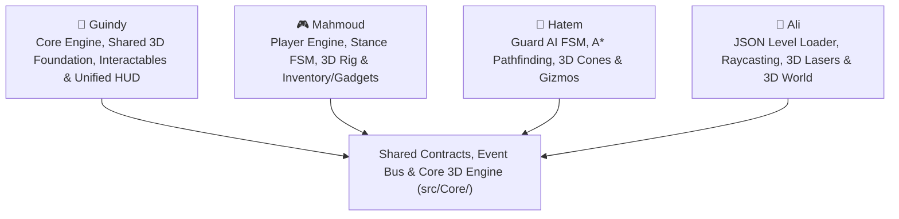
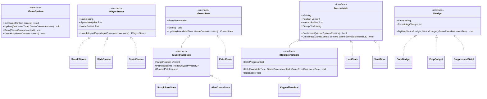

# 🕵️‍♂️ ShadowHeist (`Raylib-cs`) — 4-Week Engineering & Architecture Plan

> [!IMPORTANT]
> **Project Mission:** Build a polished **100% Native 3D Isometric Tactical Stealth Heist** game in C# (`.NET 8` + `Raylib-cs`) while mastering **Clean C# Architecture (SOLID, Interfaces, Design Patterns, LINQ, Unit Testing)** and **Professional GitHub Workflows (Feature Branches, Pull Requests, Mandatory Peer Code Reviews)** ahead of the Graduation Project.
> **Current Milestone Status:** **Weeks 1 & 2 (`#1`–`#16`)**, **Native 3D Tactical Overhaul (`#33`–`#36`)**, and **`#21` (`AlertChaseState`)** are **complete, merged, and verified** with **97 passing `xUnit` unit tests** (`0` warnings, `0` errors), strict `<200`-line files in `src/`, and Newspaper Layout across every module.

---

## 1. Team Ownership & Subsystem Architecture

To prevent merge conflicts and ensure clean separation of concerns, each engineer owns **one decoupled C# namespace/folder**, while **all 4 team members review each other's Pull Requests**. Shared 3D rendering primitives, cel-shaded `ToonModelLibrary`, character animation, and `TacticalCameraController` live in `src/Core/Rendering3D/` with zero dependencies on feature modules.



### Subsystem Breakdown by Engineer

| Engineer | Assigned Module (`src/`) | Key Systems Owned | Core Engineering Patterns Practiced |
| :--- | :--- | :--- | :--- |
| **Guindy** | `src/Core/` & `src/HeistWorld/` | `GameContext`, `GameEventBus`, `Core/Rendering3D/` (`TacticalCameraController`, `ToonModelLibrary`, `CharacterMeshDrawer`), `VaultDoor`, `KeypadTerminal`, `LootCrate`, `FuseBox`, `HeistWorldRenderer`, `HudRenderer`, `GameStateManager` | **Observer Pattern (Event Bus)**, **Polymorphism (`IInteractable`, `IHoldInteractable`)**, Dependency Injection, High-Level State Machines |
| **Mahmoud** | `src/PlayerSystem/` | `IInputProvider` (`KeyboardInputProvider`), `Player`, Stances (`SneakStance`, `WalkStance`, `SprintStance`), `PlayerRenderer`, `PlayerSoundRippleRenderer`, upcoming `PlayerInventory` & `IGadget` (`CoinGadget`, `EmpGadget`, `SuppressedPistol`) | **Dependency Injection (`IInputProvider`)**, **State Pattern (`IPlayerStance`)**, **Strategy Pattern (`IGadget`)**, **C# Collections & LINQ**, **xUnit Testing** |
| **Hatem** | `src/GuardAI/` | `Guard`, AI States (`PatrolState`, `SuspiciousState`, `AlertChaseState`), `IGuardPathState`, `GuardSensorHelper`, `AStarPathfinder` & `GridGraph`, `GuardRenderer`, `GuardPathGizmo3DRenderer`, upcoming `SecurityCamera` & Detection Meter | **Finite State Machine (`IGuardState`)**, **Graph Algorithms (A\*)**, Event-Driven AI Transitions, **xUnit Testing** |
| **Ali** | `src/WorldLighting/` | JSON `MapLoader` & `LevelMapData`, `CollisionHelper`, `VisionRaycaster`, `LaserTripwire`, `Architecture3DRenderer`, `Furniture3DRenderer`, `BankDecorRenderer`, `LaserTripwire3DRenderer`, `VisionCone3DRenderer`, upcoming lighting/glass hazards | **Data-Driven Design (JSON DTOs)**, **Computational Geometry (Raycasting)**, Modular 3D Environment Pipelines |

---

## 2. Clean C# Architecture Blueprint (SOLID & Zero Merge Conflicts)

> [!TIP]
> **Clean Code & Structural Rules:** Every `.cs` file in `src/` stays strictly **under 200 lines**, follows **Newspaper Layout** (public entry points at top, private helpers below in call order), avoids noisy inline comments, and isolates Raylib 3D rendering into dedicated `Rendering/` classes so all gameplay systems run headlessly in `xUnit`.

### Folder Structure (`ShadowHeist.sln`)

```text
ShadowHeist/
├── assets/
│   ├── maps/                     # level1_city_bank.json (+ planned level2_penthouse.json)
│   ├── models/
│   │   ├── characters/           # Articulated low-poly parts, basicCharacter, skins
│   │   ├── furniture/            # Sofas, chairs, tables, rugs, lamps, plants + palette
│   │   └── props/                # getaway_van.obj + props_palette.png
│   ├── shaders/                  # toon.vs/fs, outline.vs/fs (+ planned shadow_mask.fs, bloom.fs)
│   └── sprites/                  # Floors, reinforced wall textures, UI & prop textures
├── src/
│   ├── Program.cs                # Entry point (<100 lines): RegisterSystems, hotkeys, 3D + HUD passes
│   ├── Core/                     # Shared Contracts, Events & Core 3D Engine (Guindy)
│   │   ├── Interfaces/
│   │   │   ├── IGameSystem.cs    # Init, Update, Draw, DrawHud
│   │   │   ├── IInputProvider.cs
│   │   │   ├── IPlayerStance.cs
│   │   │   ├── IInteractable.cs
│   │   │   ├── IGuardState.cs
│   │   │   └── IGadget.cs
│   │   ├── Events/               # GameEventBus, NoiseEmittedEvent, NoiseCategory, AlarmTriggeredEvent
│   │   ├── Rendering3D/          # Viewport3DConfig, TacticalCameraController, ToonModelLibrary,
│   │   │                         # ToonShaderUniforms, CharacterPoseAnimator, CharacterMeshDrawer, Raylib3DPrimitives
│   │   ├── GameContext.cs
│   │   └── HeistConstants.cs
│   ├── PlayerSystem/             # 🎮 Owned by Mahmoud
│   │   ├── PlayerSystemModule.cs
│   │   ├── Player.cs
│   │   ├── Input/                # KeyboardInputProvider.cs
│   │   ├── Stances/              # SneakStance.cs, WalkStance.cs, SprintStance.cs
│   │   ├── Rendering/            # PlayerRenderer.cs, PlayerSoundRippleRenderer.cs
│   │   ├── Inventory/            # Planned (#19): PlayerInventory.cs
│   │   └── Gadgets/              # Planned (#20, #27): CoinGadget.cs, EmpGadget.cs, SuppressedPistol.cs
│   ├── HeistWorld/               # 👤 Owned by Guindy
│   │   ├── HeistWorldModule.cs
│   │   ├── InteractionController.cs
│   │   ├── InteractableQuery.cs
│   │   ├── Interactables/        # WorldObject.cs, IHoldInteractable.cs, VaultDoor.cs, KeypadTerminal.cs, LootCrate.cs
│   │   ├── Rendering/            # HeistWorldRenderer.cs, LootSparkRenderer.cs
│   │   └── UI/                   # HudRenderer.cs, SoundMeter.cs, SoundMeterBarRenderer.cs,
│   │                             # HoldProgressRingRenderer.cs, HudPromptRenderer.cs
│   ├── GuardAI/                  # 🧠 Owned by Hatem
│   │   ├── GuardAiModule.cs
│   │   ├── Guard.cs
│   │   ├── GuardSensorHelper.cs
│   │   ├── States/               # IGuardPathState.cs, PatrolState.cs, SuspiciousState.cs, AlertChaseState.cs
│   │   ├── Pathfinding/          # GridCoord.cs, GridGraph.cs, AStarPathfinder.cs
│   │   └── Rendering/            # GuardRenderer.cs, GuardPathGizmo3DRenderer.cs
│   └── WorldLighting/            # 🔦 Owned by Ali
│       ├── WorldLightingModule.cs
│       ├── MapLoader.cs
│       ├── LevelMapData.cs
│       ├── CollisionHelper.cs
│       ├── VisionRaycaster.cs
│       ├── LaserTripwire.cs
│       └── Rendering/            # Architecture3DRenderer.cs, Furniture3DRenderer.cs, BankFurnitureLayout.cs,
│                                 # BankDecorRenderer.cs, LaserTripwire3DRenderer.cs, VisionCone3DRenderer.cs
└── tests/
    └── ShadowHeist.Tests/        # 15 xUnit test files (97 passing automated tests)
```

### Core Interfaces & Design Patterns Diagram



1. **Input & Rendering Separation (Single Responsibility Principle):**
   * In `src/PlayerSystem/`, **Mahmoud** separates input reading (`KeyboardInputProvider : IInputProvider`) from player logic (`Player.cs`) and 3D rendering (`PlayerRenderer.cs`, `PlayerSoundRippleRenderer.cs`). All domain classes stay 100% unit-testable without a window.
2. **State Pattern Over `if/else` Chains:**
   * Both **Mahmoud** (`IPlayerStance`) and **Hatem** (`IGuardState` / `IGuardPathState`) use polymorphism so movement and AI transitions remain small, modular, and Open/Closed.
3. **Dependency Inversion & Event Bus:**
   * When `Player` sprints or activates a distraction, it publishes `NoiseEmittedEvent` on `GameEventBus`. `GuardAiModule`, `PlayerSoundRippleRenderer`, and `SoundMeter` subscribe independently with zero cross-module coupling.

---

## 3. GitHub Workflow & Peer PR Review Playbook

> [!NOTE]
> **Team Standard:** Every feature is built on a short-lived branch, verified to compile cleanly with all `xUnit` tests passing, and merged via a **Pull Request (PR)** reviewed by teammates.

### Rule 1: Branch Protection & Naming Convention
* Direct pushes to `main` are disabled.
* Branch naming format: `<type>/<owner>-<short-description>`
  * `feat/mahmoud-inventory-linq`
  * `feat/hatem-detection-meter`
  * `feat/ali-shadow-renderer`
  * `feat/guindy-fusebox-laserswitch`

### Rule 2: The Daily Git Routine (5 Commands)
```bash
# 1. Switch to main and pull latest merged team code
git checkout main
git pull origin main

# 2. Create a branch for ONE ticket only
git checkout -b feat/mahmoud-inventory-linq

# 3. Verify build & tests pass cleanly locally
dotnet build && dotnet test

# 4. Push branch to GitHub and open a Pull Request
git push -u origin feat/mahmoud-inventory-linq
```

### Rule 3: Mandatory Peer Review Matrix (2 Approvals Required)

| PR Author | Primary Reviewer | Secondary Reviewer | What Reviewers Focus On |
| :--- | :--- | :--- | :--- |
| **Mahmoud** | Hatem | Guindy | `IInputProvider` DI, clean State/Strategy classes, LINQ correctness, `<200`-line files |
| **Hatem** | Guindy | Ali | Guard FSM state transitions, `AStarPathfinder` caching/safety, Newspaper Layout |
| **Ali** | Mahmoud | Guindy | JSON DTO models, raycast math helpers, 3D renderer modularity |
| **Guindy** | Hatem | Ali | `Core` contracts, `Rendering3D` resource disposal order, `IInteractable` & HUD clarity |

### Rule 4: The Enforced Clean Code PR Checklist (`.github/pull_request_template.md`)
* [ ] **Builds & Tests Cleanly:** Does `dotnet build && dotnet test` succeed with `0` warnings and `0` errors?
* [ ] **Strict `<200`-Line File Limit:** Is every `.cs` file in `src/` strictly under **200 lines** with clear single responsibility?
* [ ] **Newspaper Layout:** Are public constructors/methods placed at the top and private helpers ordered logically underneath?
* [ ] **Self-Documenting Code & Named Constants:** Are names descriptive, magic numbers extracted to named constants, and inline comments avoided?
* [ ] **Module Boundaries:** Did the PR stay inside its assigned module and communicate across subsystems only via `src/Core/` interfaces and `GameEventBus`?

---

## 4. The 4-Week Sprint Plan & Ticket Backlog (36 GitHub Issues)

Each week wraps up with a **Friday 30-Minute Merge & Playtest Session** where everyone pulls `main` and playtests the integrated 3D build.

### 🗓️ Week 1: Core Skeleton, Input Abstraction, Map Loading & First Patrols (`#1`–`#8` ✅ Completed)

| Ticket | Status | Owner | Task Description | Engineering Focus |
| :--- | :--- | :--- | :--- | :--- |
| **#1** | ✅ | 👤 Guindy | Initialize skeleton (`GameContext`, `IGameSystem`, `IInteractable`, `GameEventBus`) | Interfaces & DI |
| **#2** | ✅ | 👤 Guindy | Implement `LootCrate.cs : IInteractable` & `HudRenderer.cs` (`\$0 / \$500,000`) | Interface implementation |
| **#3** | ✅ | 🎮 Mahmoud | Create `IInputProvider` + `KeyboardInputProvider.cs` returning `PlayerInputCommand` | Input Abstraction (DI) |
| **#4** | ✅ | 🎮 Mahmoud | Implement `Player.cs` movement & smooth mouse-aim rotation separated from rendering | Single Responsibility |
| **#5** | ✅ | 🧠 Hatem | Create `Guard.cs` entity + `PatrolState.cs : IGuardState` | State Pattern basics |
| **#6** | ✅ | 🧠 Hatem | Add smooth guard rotation (`MoveTowardsAngle`) + patrol gizmos | Math encapsulation |
| **#7** | ✅ | 🔦 Ali | Create `MapLoader.cs` loading walls, obstacles, interactables & guards from JSON | Data-Driven Design (DTOs) |
| **#8** | ✅ | 🔦 Ali | Implement `CollisionHelper.ResolveWallCollision` & `HasLineOfSight` | Pure static helpers |

### 🗓️ Week 2: State Machines, Event Bus, Vision Raycasting & Keypad Hacking (`#9`–`#16` ✅ Completed)

| Ticket | Status | Owner | Task Description | Engineering Focus |
| :--- | :--- | :--- | :--- | :--- |
| **#9** | ✅ | 👤 Guindy | Create `VaultDoor.cs` & `KeypadTerminal.cs : IHoldInteractable` (hold `E` to unlock) | Composition & IDs |
| **#10** | ✅ | 👤 Guindy | Add animated `SoundMeter` / `SoundMeterBarRenderer` & `HoldProgressRingRenderer` via EventBus | Observer Pattern in UI |
| **#11** | ✅ | 🎮 Mahmoud | Implement `IPlayerStance`: `SneakStance.cs`, `WalkStance.cs`, and `SprintStance.cs` | State Pattern |
| **#12** | ✅ | 🎮 Mahmoud | Publish `NoiseEmittedEvent` from active stance (silent crouch vs. loud sprint) | Event-Driven Publishing |
| **#13** | ✅ | 🧠 Hatem | Implement `SuspiciousState.cs : IGuardPathState` (hears `NoiseEmittedEvent`, investigates) | Event-driven FSM |
| **#14** | ✅ | 🧠 Hatem | Implement 2D Grid `AStarPathfinder.cs` & `GridGraph.cs` around walls | Algorithm encapsulation |
| **#15** | ✅ | 🔦 Ali | Implement `VisionRaycaster.cs` computing wall-clipped FOV visibility polygons | Ray-segment math |
| **#16** | ✅ | 🔦 Ali | Create `LaserTripwire.cs` firing `AlarmTriggeredEvent` on wall-clipped contact | Raycasting & Events |

> [!NOTE]
> **Noise Attribution Contract (`NoiseCategory` in Core):**
> `NoiseEmittedEvent` includes `NoiseCategory Category = NoiseCategory.Player` (`Player`, `Distraction`, `Environment`). `SoundMeter` filters for `NoiseCategory.Player`, while `GuardAI` reacts to all audible categories. In Ticket #20 (`CoinGadget`), pass `NoiseCategory.Distraction` so remote coin throws lure guards without spiking the player's personal stealth meter.

---

### 🗓️ Week 3: Native 3D Overhaul (✅ Done) + Inventory, Gadgets & Sensors (`#33`–`#36`, `#21` ✅ Done; `#17`–`#20`, `#22`–`#24` In Progress)

**Goal:** Run the entire game natively in **3D Isometric Tactical View (`src/Core/Rendering3D/` + per-module `Rendering/` classes)** while delivering `FuseBox`/`LaserSwitch`, `TacticalCameraController` shake/peek, `PlayerInventory` (LINQ), `IGadget`, Guard Detection Meter, and 3D darkness/glass hazards.

| Ticket | Status | Owner | Task Description | Engineering Focus |
| :--- | :--- | :--- | :--- | :--- |
| **#33** | ✅ | 👤 Guindy | **Native 3D Engine & Camera (`src/Core/Rendering3D/`):** `TacticalCameraController` (`[F6]` Follow/Overview, scroll zoom, `ScreenToGroundPoint`), `ToonModelLibrary` (`toon.fs` + `outline.fs`), `CharacterPoseAnimator`, `CharacterMeshDrawer`, and unified `HudRenderer` (`GetWorldToScreen` rings & prompts). | Ray-Plane Math & Shared 3D Core |
| **#34** | ✅ | 🔦 Ali | **Native 3D Environment (`src/WorldLighting/Rendering/`):** `Architecture3DRenderer` (textured 3D concrete walls & multi-zone floor tiles), `Furniture3DRenderer` + `BankDecorRenderer` (sofas, lamps, plants, getaway van), `LaserTripwire3DRenderer`, and `VisionCone3DRenderer`. | 3D Geometry & Modular Renderers |
| **#35** | ✅ | 🎮 Mahmoud | **Native 3D Player Presentation (`src/PlayerSystem/Rendering/`):** Articulated cel-shaded 3D thief rig with stance pose animation, weapon prop, ground ring (`PlayerRenderer`), and expanding 3D floor acoustic ripples (`PlayerSoundRippleRenderer`). | Character Animation & 3D VFX |
| **#36** | ✅ | 🧠 Hatem | **Native 3D Guard & Path Presentation (`src/GuardAI/Rendering/`):** Articulated 3D guard rigs + flashlights, wall-clipped 3D floor vision cones, overhead `?`/`!` badges (`GuardRenderer`), and 3D patrol/A* path/noise ring gizmos (`GuardPathGizmo3DRenderer`). | 3D Gizmos & Open/Closed `IGuardPathState` |
| **#21** | ✅ | 🧠 Hatem | **Alert Chase State:** `AlertChaseState.cs : IGuardPathState` + `GuardSensorHelper` (vision detection, alarm broadcast, A* pursuit around walls, and `HeistOutcome.Caught`). | Complete Guard FSM & A* Pursuit |
| **#17** | 🔜 | 👤 Guindy | Create `FuseBox.cs` & `LaserSwitch.cs : IInteractable` publishing `PowerStateChangedEvent` to toggle linked lights/lasers | Loose coupling via EventBus IDs |
| **#18** | 🔜 | 👤 Guindy | Extend `TacticalCameraController` with alarm camera shake & Right-Click directional tactical peek | Clean 3D Camera Effects |
| **#19** | 🔜 | 🎮 Mahmoud | Build `PlayerInventory.cs` using `List<LootItem>`, `Dictionary`, and **LINQ** (`Sum` for loot weight slowdown) | C# Collections & LINQ |
| **#20** | 🔜 | 🎮 Mahmoud | Implement `IGadget` Strategy Pattern: `CoinGadget.cs` (`NoiseCategory.Distraction`) & `EmpGadget.cs` in 3D | Strategy Pattern (`IGadget`) |
| **#22** | 🔜 | 🧠 Hatem | Add progressive Guard Detection Meter (`0% -> 100%` fill scaling with distance/sneak) driving 3D `?`/`!` gauges, slightly increase guard speed, expand guard vision when the alarm is triggered, and add a close-proximity awareness circle around guards so players standing right next to them are detected even outside their forward cone | Clean state timers & sensors |
| **#23** | 🔜 | 🔦 Ali | Enhance `WorldLighting/Rendering` dynamic 3D lighting & darkness/shadow mood pass | Custom 3D Lighting Pipeline |
| **#24** | 🔜 | 🔦 Ali | Ensure `LaserTripwire` triggers reliably whenever the player passes through the beam, plus add `BrokenGlassTile` 3D floor hazard (spikes footstep noise) & emissive keypad glow accents | World Hazard Integration |

> [!NOTE]
> **Week 3 Architecture Contracts (#17 & #18):**
> - **Draw-Pass Split (`IGameSystem`):** `Program.cs` calls `context.DrawAll()` inside `BeginMode3D(context.Camera.Camera)` for world 3D meshes/gizmos, then calls `context.DrawHudAll()` in screen space after `EndMode3D()`, keeping all `DrawHud` projection (`GetWorldToScreen`) isolated to UI renderers.
> - **Power Mechanism (#17):** Use `PowerStateChangedEvent(string TargetGroupId, bool IsPowered)` on `GameEventBus` (`FuseBox` one-shot `[E] Cut Power`; `LaserSwitch` toggle).

---

### 🗓️ Week 4: Menus, Security Cameras, Level 2, Audio/Bloom & Final Polish (`#25`–`#32`)

| Ticket | Status | Owner | Task Description | Engineering Focus |
| :--- | :--- | :--- | :--- | :--- |
| **#25** | 🔜 | 👤 Guindy | Implement `GameStateManager` (`MainMenu` $\rightarrow$ `LevelSelect` $\rightarrow$ `Playing` $\rightarrow$ `Paused` $\rightarrow$ `Summary`), Start Menu, Pause Menu (`Esc`, `[F6]` Overview, `[R]` Restart), and 3D `GetawayVanZone` extraction UI | High-level State Machine & UI Screens |
| **#26** | 🔜 | 👤 Guindy | Build Mission Summary Screen (`SummaryScreen.cs`: Timer, Loot, Alarms, Stealth Rank `S/A/B/C`) + final `README.md` | Documentation & UI States |
| **#27** | 🔜 | 🎮 Mahmoud | Add `SuppressedPistol.cs : IGadget` (limited rounds to disable lights or stun guards, with 3D tracer VFX) | Extending `IGadget` cleanly |
| **#28** | 🔜 | 🎮 Mahmoud | Expand `xUnit` tests covering `PlayerInventory` weight math, stance noise, and gadget charges | Automated Unit Testing |
| **#29** | 🔜 | 🧠 Hatem | Create wall-mounted 3D `SecurityCamera.cs` with sweeping `VisionRaycaster` cone (disabled by EMP/`FuseBox`) | Component Reuse |
| **#30** | 🔜 | 🧠 Hatem | Expand `xUnit` tests covering `DetectionMeter`, `SecurityCamera`, and `AlertChaseState` A* edge cases | Automated Unit Testing |
| **#31** | 🔜 | 🔦 Ali | Design **Level 2 (`level2_penthouse.json`)** multi-room bank/penthouse layout + furniture & laser placements | Content Pipeline |
| **#32** | 🔜 | 🔦 Ali | Add GLSL Bloom post-processing (`bloom.fs`) + **SFX-only** `AudioManager : IDisposable` (alarm, footsteps, glass, coin, EMP, loot/UI clicks — **no background music**) with safe teardown order before `CloseWindow()` | Resource Lifecycle (`IDisposable`) |

> [!IMPORTANT]
> **Audio Policy (#32 — SFX Only, Zero Music):**
> `AudioManager` must **not** include background music, soundtracks, or musical instruments anywhere in the game (menus, gameplay, or summary). Use strictly realistic/tactical **sound effects (`Sound`)** triggered via `GameEventBus` and UI states (e.g., alarm klaxon on `AlarmTriggeredEvent`, footsteps/glass/coin clink on `NoiseEmittedEvent`, EMP zap & breaker clunk on `PowerStateChangedEvent`, loot/keypad/vault clicks, and mute toggle), guarded by `Raylib.IsAudioDeviceReady()` for headless test safety.

---

## 5. 📐 Native 3D Tactical Architecture & Asset Reference

> [!TIP]
> **Proof of Decoupled Architecture:**
> Every simulation rule (`Player`, `Guard`, `AStarPathfinder`, `CollisionHelper`, `VisionRaycaster`, `LaserTripwire`, `VaultDoor`, `KeypadTerminal`, `SoundMeter`) operates strictly on the 2D logical plane `(X, Y)`. Moving from dual-mode 2D/`Viewport3D` to **100% Native 3D** preserved 100% of game logic while giving all 4 modules their own focused `Rendering/` sublayer backed by `src/Core/Rendering3D/`.

### 5.1 2D Logical Plane to 3D World Mapping

```mermaid
flowchart LR
    subgraph Simulation["Pure 2D Logic Plane (X, Y) — Headless & Tested (97 xUnit Tests)"]
        P2D["Player.Position (X, Y)"]
        G2D["Guard.Position (X, Y)"]
        W2D["RectangleBounds Walls & Furniture"]
        AStar["AStarPathfinder GridGraph"]
        Ray2D["VisionRaycaster Polygon"]
    end

    subgraph Rendering3D["Native Raylib 3D Layer (src/Core/Rendering3D + Module Rendering/)"]
        FloorWalls["Architecture3DRenderer + Furniture3DRenderer"]
        Chars["CharacterMeshDrawer (Cel-Shaded Rig + Outline Shader)"]
        Cones["VisionCone3DRenderer (Y = 2.0 Ground Projected)"]
        Gizmos["GuardPathGizmo3DRenderer + PlayerSoundRippleRenderer"]
        Hud["HudRenderer.DrawHud (GetWorldToScreen Overlays + HUD Bars)"]
    end

    Simulation -->|"World (x, y) -> 3D (x, heightY, y)"| Rendering3D
```



* **Coordinate Mapping Formula:** Logical `(pos.X, pos.Y)` maps to 3D `new Vector3(pos.X, heightY, pos.Y)`.
* **Mouse Ground Picking:** `TacticalCameraController.ScreenToGroundPoint` casts `Raylib.GetMouseRay(mousePos, _camera)` onto `Y = 0` (`hitDistance = -ray.Position.Y / ray.Direction.Y`) and writes `GameContext.AimWorldOverride` for both player aiming (`PlayerSystem`) and 3D click-to-noise debugging (`GuardAiModule`).
* **OpenGL Disposal Safety:** `Program.cs` disposes `GameContext` (`ToonModelLibrary`, textures, shaders) **inside `try`** *before* `finally { Raylib.CloseWindow(); }` to ensure clean GPU resource release on Linux/Windows without segfaults.

### 5.2 Ground, Shader & 3D Model Assets

| Asset Folder | Key Assets | 3D Role & Visual Contrast Profile |
| :--- | :--- | :--- |
| `assets/shaders/` | `toon.vs`, `toon.fs`, `outline.vs`, `outline.fs` | Cel-shaded 3D lighting + comic silhouette outlines; uniforms updated per frame in `ToonShaderUniforms` for lobby lamps and guard flashlights |
| `assets/models/characters/` | `part_head.obj`, `part_body.obj`, `part_arm_*.obj`, `part_leg_*.obj`, `skin_thief.png`, `skin_guard.png` | Articulated character rigs animated by `CharacterPoseAnimator` and drawn via `CharacterMeshDrawer` |
| `assets/models/furniture/` | `loungeSofa`, `loungeChair`, `tableCoffee`, `table`, `rugRectangle`, `lampRoundFloor`, `plantSmall1`, `pottedPlant` | Low-poly bank lobby furniture placed around centered AABB colliders from `level1_city_bank.json` |
| `assets/models/props/` | `getaway_van.obj`, `props_palette.png` | 3D extraction vehicle parked outside the getaway zone |
| `assets/sprites/` | `floor_marble_dark.png`, `floor_slate_corridor.png`, `floor_vault_steel.png`, `wall_reinforced_concrete.png`, `prop_loot_crate.png` | High-contrast architectural floor tiles and reinforced wall/crate textures |

### 🎓 Graduation Defense Summary
> *"ShadowHeist pairs a strictly decoupled, headless C# stealth simulation (`Player`, `Guard` FSM, `AStarPathfinder`, `VisionRaycaster`, `LaserTripwire`, `IInteractable`, `GameEventBus`) with a modular Native 3D presentation layer (`src/Core/Rendering3D/` + per-module `Rendering/` folders) using custom GLSL cel-shading and comic outlines. Every source file stays under 200 lines in Newspaper Layout, and all 97 `xUnit` tests execute headlessly in ~0.1s against the exact same simulation rules rendered in 3D."*
