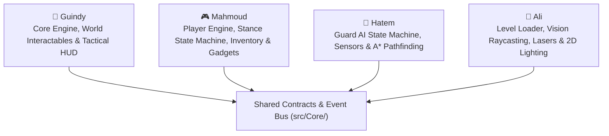
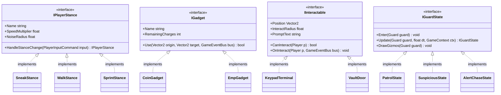

# 🕵️‍♂️ ShadowHeist (`Raylib-cs`) — 4-Week Engineering & Architecture Plan

> [!IMPORTANT]
> **Project Mission:** Build a polished **Gritty 2D Top-Down Stealth Heist** game in C# (`Raylib-cs`) while mastering **Clean C# Architecture (SOLID, Interfaces, Design Patterns, LINQ, Unit Testing)** and **Professional GitHub Workflows (Feature Branches, Pull Requests, Mandatory Peer Code Reviews)** ahead of the Graduation Project.

---

## 1. Team Ownership & Subsystem Architecture

To prevent merge conflicts and ensure clean separation of concerns, each engineer owns **one decoupled C# namespace/folder**, while **all 4 team members review each other's Pull Requests**.



### Subsystem Breakdown by Engineer

| Engineer | Assigned Module (`src/`) | Key Systems Owned | Core Engineering Patterns Practiced |
| :--- | :--- | :--- | :--- |
| **Guindy** | `src/Core/` & `src/HeistWorld/` | `GameContext`, `GameEventBus`, `VaultDoor`, `KeypadTerminal`, `LootCrate`, `FuseBox`, `HudRenderer`, `GameStateManager` | **Observer Pattern (Event Bus)**, **Polymorphism (`IInteractable`)**, High-Level State Management |
| **Mahmoud** | `src/PlayerSystem/` | `IInputProvider`, `PlayerMovement`, `PlayerRenderer`, Stances (`SneakStance`, `WalkStance`, `SprintStance`), `PlayerInventory`, Gadgets (`CoinGadget`, `EmpGadget`, `SuppressedPistol`) | **Dependency Injection (`IInputProvider`)**, **State Pattern (`IPlayerStance`)**, **Strategy Pattern (`IGadget`)**, **C# Collections & LINQ**, **xUnit Testing** |
| **Hatem** | `src/GuardAI/` | `Guard`, AI States (`PatrolState`, `SuspiciousState`, `AlertChaseState`), `SecurityCamera`, Detection Meter, 2D Grid `AStarPathfinder` | **Finite State Machine (`IGuardState`)**, **Graph Algorithms (A\*)**, Event-Driven AI Transitions, **xUnit Testing** |
| **Ali** | `src/WorldLighting/` | JSON `MapLoader`, Wall Collision, `VisionRaycaster` (2D line-of-sight polygons), `LaserTripwire`, `BrokenGlassTile`, `ShadowRenderer` & Bloom Shader | **Data-Driven Design (JSON DTOs)**, **Computational Geometry (Raycasting)**, Custom Render Pipelines (`RenderTexture2D` & GLSL) |

---

## 2. Clean C# Architecture Blueprint (SOLID & Zero Merge Conflicts)

> [!TIP]
> **The Golden Rule of Team Git:** Never let 4 engineers edit `Program.cs` at the same time. On Day 1, `Program.cs` is locked at ~40 lines of code, and each engineer only adds/edits classes inside their own folder under `src/`.

### Folder Structure (`ShadowHeist.sln`)

```text
ShadowHeist/
├── assets/
│   ├── sprites/          # Player, Guard, Furniture, Vault, Loot PNGs
│   ├── shaders/          # 2d_lighting.fs, bloom.fs
│   ├── maps/             # level1_bank.json, level2_penthouse.json
│   └── audio/            # footstep.wav, hack.wav, alarm.wav
├── src/
│   ├── Program.cs        # Entry point ONLY (initializes GameManager)
│   ├── Core/             # Shared Interfaces, Structs & EventBus (Initialized on Day 1)
│   │   ├── Interfaces/
│   │   │   ├── IGameSystem.cs
│   │   │   ├── IInputProvider.cs
│   │   │   ├── IPlayerStance.cs
│   │   │   ├── IInteractable.cs
│   │   │   ├── IGuardState.cs
│   │   │   └── IGadget.cs
│   │   ├── Events/
│   │   │   ├── GameEventBus.cs
│   │   │   ├── NoiseEmittedEvent.cs
│   │   │   └── AlarmTriggeredEvent.cs
│   │   └── GameContext.cs
│   ├── PlayerSystem/     # 🎮 Owned by Mahmoud
│   │   ├── Player.cs
│   │   ├── Input/        # KeyboardInputProvider.cs, PlayerInputCommand.cs
│   │   ├── Stances/      # SneakStance.cs, WalkStance.cs, SprintStance.cs
│   │   ├── Inventory/    # PlayerInventory.cs, LootItem.cs
│   │   └── Gadgets/      # CoinGadget.cs, EmpGadget.cs, SuppressedPistol.cs
│   ├── HeistWorld/       # 👤 Owned by Guindy
│   │   ├── Interactables/# VaultDoor.cs, KeypadTerminal.cs, LootCrate.cs, FuseBox.cs
│   │   ├── UI/           # HudRenderer.cs, MainMenuScreen.cs
│   │   └── GameStateManager.cs
│   ├── GuardAI/          # 🧠 Owned by Hatem
│   │   ├── Guard.cs
│   │   ├── SecurityCamera.cs
│   │   ├── States/       # PatrolState.cs, SuspiciousState.cs, AlertChaseState.cs
│   │   └── Pathfinding/  # GridGraph.cs, AStarPathfinder.cs
│   └── WorldLighting/    # 🔦 Owned by Ali
│       ├── MapLoader.cs
│       ├── CollisionHelper.cs
│       ├── VisionRaycaster.cs
│       ├── LaserTripwire.cs
│       └── ShadowRenderer.cs
└── tests/
    └── ShadowHeist.Tests/# xUnit tests for PlayerInventory, Stances, and AStarPathfinder
```

### Core Interfaces & Design Patterns Diagram



1. **Input & Rendering Separation (Single Responsibility Principle):**
   * In `src/PlayerSystem/`, **Mahmoud** separates input reading (`KeyboardInputProvider : IInputProvider`) from player logic (`Player.cs`) and rendering (`PlayerRenderer.cs`). This makes `Player` and `PlayerInventory` 100% unit-testable without opening a Raylib window.
2. **State Pattern Over `if/else` Chains:**
   * Both **Mahmoud** (`IPlayerStance`) and **Hatem** (`IGuardState`) use the **State Pattern** so behavior changes cleanly via polymorphism instead of giant nested `if/else` blocks.
3. **Dependency Inversion & Event Bus:**
   * When **Mahmoud's** `Player` sprints or throws a `CoinGadget`, it publishes `EventBus.Publish(new NoiseEmittedEvent(pos, radius))`.
   * **Hatem's** `GuardAI` and **Guindy's** `HudRenderer` subscribe to `NoiseEmittedEvent`—zero tight coupling between files!

---

## 3. GitHub Workflow & Peer PR Review Playbook

> [!NOTE]
> **Team Standard:** Every feature is built on a short-lived branch, verified to compile cleanly, and merged via a **Pull Request (PR)** reviewed by teammates.

### Rule 1: Branch Protection & Naming Convention
* Direct pushes to `main` are disabled.
* Branch naming format: `<type>/<owner>-<short-description>`
  * `feat/mahmoud-player-stances`
  * `feat/hatem-guard-patrol-state`
  * `feat/ali-vision-raycaster`
  * `feat/guindy-keypad-terminal`

### Rule 2: The Daily Git Routine (5 Commands)
Before starting any ticket, run:
```bash
# 1. Switch to main and pull latest merged team code
git checkout main
git pull origin main

# 2. Create a branch for ONE ticket only
git checkout -b feat/mahmoud-inventory-system

# 3. Write code, verify `dotnet build` succeeds, then commit
git add .
git commit -m "feat(player): implement PlayerInventory with LINQ weight calculation"

# 4. Push branch to GitHub and open a Pull Request
git push -u origin feat/mahmoud-inventory-system
```

### Rule 3: Mandatory Peer Review Matrix (Everyone Reviews!)
Every Pull Request requires **2 Approvals** before merging so all 4 team members practice reading and reviewing C# code every week:

| PR Author | Primary Reviewer | Secondary Reviewer |
| :--- | :--- | :--- |
| **Mahmoud** | Hatem | Guindy |
| **Hatem** | Mahmoud | Ali |
| **Ali** | Mahmoud | Guindy |
| **Guindy** | Hatem | Ali |

### Rule 4: The 5-Point "Clean Code" PR Checklist (`.github/pull_request_template.md`)
Every reviewer verifies these 5 points before clicking **Approve**:
* [ ] **Builds Cleanly:** Does `dotnet build` succeed with 0 errors and 0 warnings?
* [ ] **Single Responsibility:** Is each class under ~150 lines and focused on **one** clear responsibility?
* [ ] **No Magic Numbers:** Are speeds, radii, and cooldowns declared as named constants (`private const float SneakSpeed = 95f;`)?
* [ ] **C# Naming Standards:** Are classes/methods/properties `PascalCase`, private fields `_camelCase`, and interfaces prefixed with `I`?
* [ ] **Module Boundaries:** Did the PR stay inside its assigned module and communicate with other modules via interfaces/events?

---

## 4. The 4-Week Sprint Plan & Ticket Backlog (32 GitHub Issues)

Each week wraps up with a **Friday 30-Minute Merge & Playtest Session** where everyone pulls `main` and tests the integrated build together.

### 🗓️ Week 1: Core Skeleton, Input Abstraction, Map Loading & First Patrols
**Goal:** Master the Git branch $\rightarrow$ PR $\rightarrow$ Code Review workflow while getting the player, guards, and map running.

| Ticket | Owner | Task Description | Engineering Focus |
| :--- | :--- | :--- | :--- |
| **#1** | 👤 Guindy | Initialize Day-1 Skeleton (`GameContext`, `IGameSystem`, `IInteractable`, `GameEventBus`) | Interfaces & DI |
| **#2** | 👤 Guindy | Implement `LootCrate.cs : IInteractable` & basic `HudRenderer.cs` (`\$0 / \$500,000`) | Interface implementation |
| **#3** | 🎮 Mahmoud | Create `IInputProvider` + `KeyboardInputProvider.cs` returning a clean `PlayerInputCommand` struct | Input Abstraction (DI) |
| **#4** | 🎮 Mahmoud | Implement `Player.cs` movement & smooth mouse-aim rotation separated from `PlayerRenderer.cs` | Single Responsibility Principle |
| **#5** | 🧠 Hatem | Create `Guard.cs` entity + `PatrolState.cs : IGuardState` (walks between patrol waypoints) | State Pattern basics |
| **#6** | 🧠 Hatem | Add smooth guard rotation toward next waypoint + debug gizmo lines | Vector2 math encapsulation |
| **#7** | 🔦 Ali | Create `MapLoader.cs` loading walls, marble floor tiles, and entity spawns from JSON | Data-Driven Design (DTOs) |
| **#8** | 🔦 Ali | Implement `CollisionHelper.ResolveWallCollision` for smooth sliding along walls | Pure static utility functions |

---

### 🗓️ Week 2: State Machines, Event Bus, Vision Raycasting & Keypad Hacking
**Goal:** Eliminate `if/else` spaghetti with the **State Pattern** and connect modules using the **Event Bus**.

| Ticket | Owner | Task Description | Engineering Focus |
| :--- | :--- | :--- | :--- |
| **#9** | 👤 Guindy | Create `VaultDoor.cs` and `KeypadTerminal.cs : IInteractable` (holding `E` fills bypass bar) | Object composition & IDs |
| **#10** | 👤 Guindy | Add animated **Sound Meter Bar** & **Interaction Progress Ring** to `HudRenderer.cs` | Event Bus subscriptions |
| **#11** | 🎮 Mahmoud | Implement `IPlayerStance` with `SneakStance.cs`, `WalkStance.cs`, and `SprintStance.cs` | State Pattern & Polymorphism |
| **#12** | 🎮 Mahmoud | Publish `NoiseEmittedEvent` based on active stance & floor surface (silent crouch vs. loud sprint) | Event-Driven Architecture |
| **#13** | 🧠 Hatem | Implement `SuspiciousState.cs` (guard hears `NoiseEmittedEvent` and walks to investigate) | Event-driven state transitions |
| **#14** | 🧠 Hatem | Implement 2D Grid `AStarPathfinder.cs` so guards navigate cleanly around walls and rooms | Algorithm encapsulation |
| **#15** | 🔦 Ali | Implement `VisionRaycaster.cs` (computes guard vision cone polygon clipped by walls) | Ray-segment math |
| **#16** | 🔦 Ali | Create `LaserTripwire.cs` (red beam that stops at walls/player and fires `AlarmTriggeredEvent`) | Raycasting & Events |

---

### 🗓️ Week 3: Inventory/LINQ, Heist Gadgets, Alert Chase & 2D Shadow Casting
**Goal:** Build the `PlayerInventory` & `IGadget` system with C# Collections/LINQ, full guard chases, and dynamic shadows.

| Ticket | Owner | Task Description | Engineering Focus |
| :--- | :--- | :--- | :--- |
| **#17** | 👤 Guindy | Create `FuseBox.cs` & `LaserSwitch.cs : IInteractable` (disables linked room lights/lasers) | Loose coupling via IDs |
| **#18** | 👤 Guindy | Implement Camera Controller with smooth follow, screen-shake on alarm, and Right-Click peek | Clean `Camera2D` math |
| **#19** | 🎮 Mahmoud | Build `PlayerInventory.cs` using `List<LootItem>`, `Dictionary`, and **LINQ** (`Sum` for loot weight slowdown) | C# Collections, LINQ & Encapsulation |
| **#20** | 🎮 Mahmoud | Implement `IGadget` Strategy Pattern: `CoinGadget.cs` (throwable distraction) & `EmpGadget.cs` (disables electronics) | Strategy Pattern (`IGadget`) |
| **#21** | 🧠 Hatem | Implement `AlertChaseState.cs` (guard spots player, raises alarm, chases last seen position) | Complete Finite State Machine |
| **#22** | 🧠 Hatem | Add Guard Detection Meter (0% $\rightarrow$ 100% fill before instant alarm, scales with distance) | Clean timer/interpolation |
| **#23** | 🔦 Ali | Implement `ShadowRenderer.cs` using `RenderTexture2D` darkness mask + flashlight cutouts | Custom rendering pipeline |
| **#24** | 🔦 Ali | Add `BrokenGlassTile` floor hazard (multiplies footstep noise) + emissive keypad glow overlays | Layered rendering order |

---

### 🗓️ Week 4: Unit Testing, Security Cameras, Menus & Final Polish
**Goal:** Write automated `xUnit` tests on decoupled C# logic, add Level 2, and complete the full game loop.

| Ticket | Owner | Task Description | Engineering Focus |
| :--- | :--- | :--- | :--- |
| **#25** | 👤 Guindy | Implement `GameStateManager` (`MainMenu` $\rightarrow$ `Playing` $\rightarrow$ `Paused` $\rightarrow$ `Victory` / `Busted`) + `GetawayVanZone` | High-level State Machine |
| **#26** | 👤 Guindy | Build Mission Summary Screen (Time, Stolen Loot, Stealth Rating `S/A/B/C`) + Architecture `README.md` | Documentation & UI states |
| **#27** | 🎮 Mahmoud | Add `SuppressedPistol.cs : IGadget` (limited ammo to shoot out light bulbs or stun guards) | Extending `IGadget` cleanly |
| **#28** | 🎮 Mahmoud | Write **5 `xUnit` Unit Tests** testing `PlayerInventory` weight math, stance transitions, and gadget charges | Automated Unit Testing (`xUnit`) |
| **#29** | 🧠 Hatem | Create `SecurityCamera.cs` (sweeping vision cone that alerts nearby guards unless disabled by EMP/FuseBox) | Reusing `VisionRaycaster` |
| **#30** | 🧠 Hatem | Write **5 `xUnit` Unit Tests** verifying `AStarPathfinder` shortest paths and `Guard` state transitions | Automated Unit Testing (`xUnit`) |
| **#31** | 🔦 Ali | Build **Level 1 (City Bank)** and **Level 2 (Luxury Penthouse)** JSON maps + integrate HD sprite pack | Content pipeline |
| **#32** | 🔦 Ali | Add Bloom shader (`BeginShaderMode`) and `AudioManager` (`IDisposable` sound cleanup) | Resource lifecycle (`IDisposable`) |
